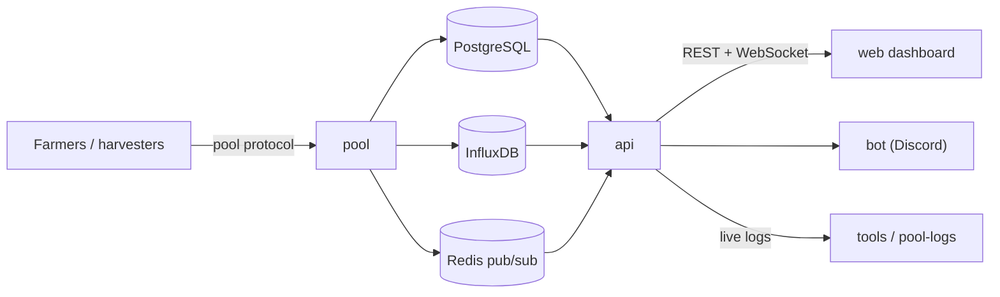

# Pool.Energy

**A Chia farming pool built on the official pool protocol — open source, self-hostable, PPLNS.**

  <picture>
    <source media="(prefers-color-scheme: dark)" srcset="https://raw.githubusercontent.com/Pool-Energy/.github/main/profile/.assets/screenshot-dark.png">
    <source media="(prefers-color-scheme: light)" srcset="https://raw.githubusercontent.com/Pool-Energy/.github/main/profile/.assets/screenshot-light.png">
    
  </picture>

  The Pool.Energy dashboard — live farmer statistics, partials, blocks, rewards and payouts.

---

## Why Pool.Energy

- **Official Chia pool protocol** — standard harvester support, no custom
  farmer software and no lock-in.
- **PPLNS rewards** with configurable difficulty, a live leaderboard and
  per-farmer effort, luck and estimated time to win.
- **Full transparency** — every block, partial, payout and address is browsable
  on the dashboard and through the public API.
- **Open source end to end** — the dashboard, the API, the pool server, the bot
  and the tooling are all in this organisation.
- **Live data** — WebSocket feeds for pool status, blocks, rewards, farmers,
  partials and pool logs.

## Repositories

| Repository | What it does | Stack |
| --- | --- | --- |
| [**web**](https://github.com/Pool-Energy/web) | The dashboard: farmers, blocks, rewards, partials, Chia state, pool stats and logs, in 7 languages. | TypeScript · Angular |
| [**api**](https://github.com/Pool-Energy/api) | REST + WebSocket API: versioned resources, generated OpenAPI schema, launcher authentication and live feeds. | Python · Django REST · Channels |
| [**pool**](https://github.com/Pool-Energy/pool) | The pool server: protocol endpoints, partial validation, difficulty adjustment, PPLNS accounting, payouts and reward absorption. | Python · asyncio · Chia |
| [**chia-blockchain**](https://github.com/Pool-Energy/chia-blockchain) | Fork of Chia pinned by the pool services, tracking the upstream release used in production. | Python · Chia |
| [**bot**](https://github.com/Pool-Energy/bot) | Discord bot: rotating pool metrics in its nickname, `!stats` and `!farmer` embeds. | Python · discord.py |
| [**tools**](https://github.com/Pool-Energy/tools) | Operational utilities, including `pool-logs` to stream live pool logs. | Python |

## How the pieces fit

## Quick links

| | |
| --- | --- |
| Dashboard | [pool.energy](https://pool.energy) |
| Join the pool | [pool.energy/join](https://pool.energy/join) |
| API documentation | [pool.energy/api/doc](https://pool.energy/api/doc/) |
| Pool status | [pool.energy/pool/status](https://pool.energy/pool/status) |
| Block explorer (XCHScan) | [xchscan.com](https://xchscan.com) |

## Join the pool

1. Install [Chia](https://www.chia.net/download/) and sync your full node.
2. Create a **Plot NFT** and choose *Join a pool*, using the pool URL
   `https://chia.pool.energy`.
3. Start plotting and farming — your launcher appears on the
   [dashboard](https://pool.energy/farmers) within a few minutes.

Full instructions, fees and payout rules are on the
[Join page](https://pool.energy/join) and the [FAQ](https://pool.energy/info/faq).

## Security

Found a vulnerability? Report it privately through GitHub security advisories
on the affected repository, or email **contact@pool.energy** — please do not
open a public issue for security reports.

## Licensing

The pool services ([web](https://github.com/Pool-Energy/web),
[api](https://github.com/Pool-Energy/api),
[pool](https://github.com/Pool-Energy/pool),
[bot](https://github.com/Pool-Energy/bot)) are released under
**AGPL-3.0**, [tools](https://github.com/Pool-Energy/tools) under **GPL-3.0**,
and the [chia-blockchain](https://github.com/Pool-Energy/chia-blockchain) fork
keeps the upstream **Apache-2.0** licence. See each repository for details.

  Made with 🌱 in the Chia ecosystem

